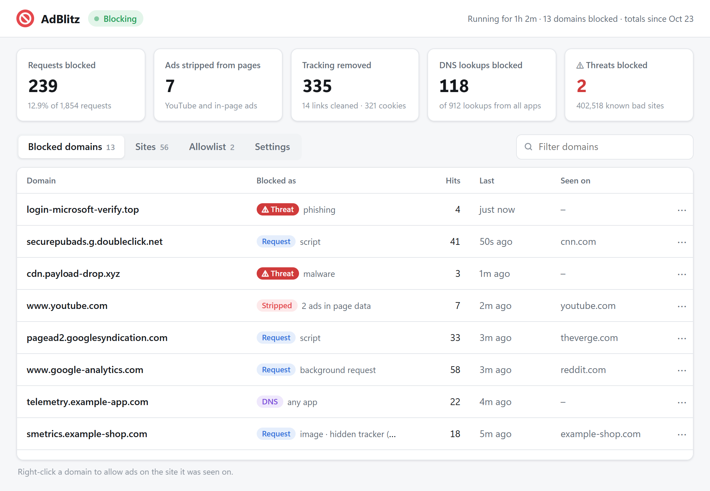
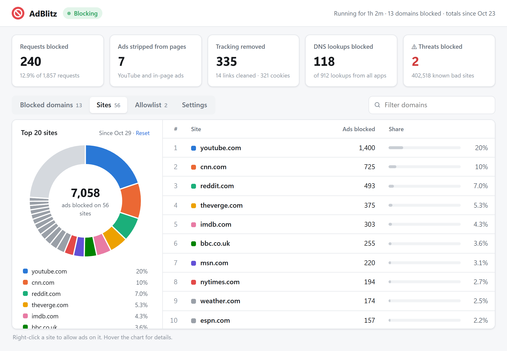
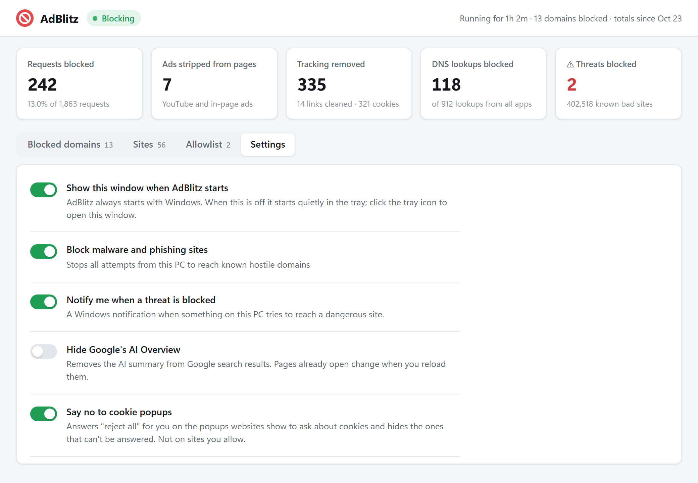

<p align="center">
  
</p>

<h1 align="center">AdBlitz</h1>

<p align="center">
  <b>Ad block your entire computer.</b><br>
  AdBlitz blocks ads and trackers for every browser and every app on your PC, with no extension to install. For free.
</p>

<p align="center">
  <a href="https://github.com/athenalab-net/adblitz-releases/releases/latest/download/adblitz.exe"><b>Download for Windows</b></a>
  &nbsp;·&nbsp;
  <a href="https://adblitz.athenalab.net">Website</a>
  &nbsp;·&nbsp;
  <a href="https://github.com/athenalab-net/adblitz-releases/releases">What's new</a>
</p>

<picture>
  <source media="(prefers-color-scheme: dark)" srcset="https://raw.githubusercontent.com/athenalab-net/adblitz-releases/main/site/screenshots/blocked-dark.png">
  
</picture>

## Features

- **Every app, not just one browser.** Ads and trackers are blocked for Chrome, Edge, Firefox, Opera, Brave and the apps on your PC. There is no extension to install.
- **YouTube ads blocked.** Watch YouTube without annoying ads.
- **Ads hidden inside pages.** Sponsored search results and ad boxes are removed, along with the empty space they leave behind.
- **Cookie popups.** Annoying cookie popups are answered "reject all" for you, or hidden when they can't be.
- **Hidden trackers blocked.** Trackers disguised as part of the site you're on are recognised and blocked.
- **Link cleaner.** Tracking tags and redirects are stripped from links, so no one can track you when you click one.
- **Third-party cookies stripped.** Trackers embedded in other sites can't set or read cookies to follow you around the web.
- **Malware and phishing blocked.** Known dangerous sites are stopped, with a warning page and a notification.
- **Asks sites not to sell your data.** Every request tells websites not to sell or share your data, using Global Privacy Control.
- **Turn off Google's AI Overview.** Optionally remove the AI summary from the top of Google search results.
- **Keeps itself up to date.** Rules refresh every few hours, and new versions install themselves. Every update is signed.

## See where the ads were

The **Sites** tab shows the websites AdBlitz blocked the most ads on over the last 30 days. Right-click a site to allow ads on it.

<picture>
  <source media="(prefers-color-scheme: dark)" srcset="https://raw.githubusercontent.com/athenalab-net/adblitz-releases/main/site/screenshots/sites-dark.png">
  
</picture>

## Your choices

Every feature can be switched on or off in **Settings**. To see whether AdBlitz is behind a problem on a site, pause it from the tray icon for 15 minutes up to 6 hours.

<picture>
  <source media="(prefers-color-scheme: dark)" srcset="https://raw.githubusercontent.com/athenalab-net/adblitz-releases/main/site/screenshots/settings-dark.png">
  
</picture>

## How it works

AdBlitz runs on your PC. Windows sends your web traffic through it, and it stops ads, trackers and dangerous sites before they reach your browser or apps.

- **It checks every request** against more than 160,000 rules for ads, trackers and malware, updated every few hours. Each check takes a few microseconds, so you won't notice it.
- **Your browsing stays on your PC.** There's no account and no AdBlitz server. Filtering happens on your computer, and your statistics stay on it.
- **Set up once.** Install it and forget it. AdBlitz starts with Windows and keeps itself up to date.

## Install

1. Download [**adblitz.exe**](https://github.com/athenalab-net/adblitz-releases/releases/latest/download/adblitz.exe).
2. Run it and click **Yes** when Windows asks for permission. AdBlitz starts blocking right away and starts with Windows from now on.

AdBlitz isn't code-signed yet, so Windows may show "Windows protected your PC". Click **More info**, then **Run anyway**.

## Uninstall

**Settings › Apps › Installed apps › AdBlitz › Uninstall.** Your network settings are put back exactly as they were.

## Verify your download

Each [release](https://github.com/athenalab-net/adblitz-releases/releases) lists the SHA-256 of its `adblitz.exe`. To check yours, in PowerShell:

```
Get-FileHash .\adblitz.exe
```

`adblitz.exe.sig` is the signature installed copies check before updating. You don't need to download it.

## About this repository

This repository holds the AdBlitz website and its releases. AdBlitz is made by [Athena Lab](https://adblitz.athenalab.net).

Questions or problems: contact@athenalab.net
